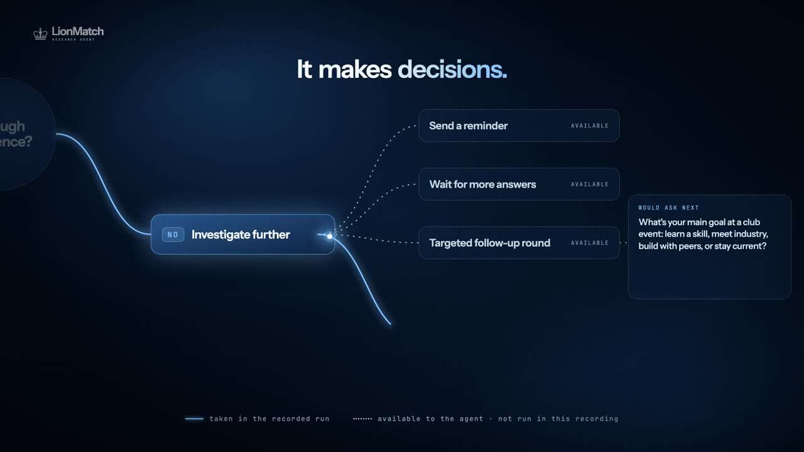

# LionMatch Research Agent

[](https://github.com/junhorkan/lionmatch-research-agent/actions/workflows/test.yml)

**LionMatch decides what to build next by asking its own users, through an agent.**

[LionMatch](https://github.com/4amGrind/LionMatch) is our swipe-to-match app for Columbia
internships, research, clubs and fellowships, which placed 3rd in the main hackathon. It already
calls Flashpoint at runtime: an "Ask students" button pays a cent for a read on demand for a
listing. This add-on goes a step further. Instead of answering one question, the agent runs the
research behind a product decision, end to end.

Give it one objective and an email list. It writes its own survey and gets Flashpoint's surveys
agent to build and publish it. It emails the survey to the list, reads the answers and decides
whether they settle the objective. If they don't, it writes a follow-up aimed at what is still open
and sends that to the same people. Then it commits to a recommendation.

No survey question, analysis or stopping rule is written in this repo. The model produces them at
run time, and code checks the facts its decisions rest on. Nothing in the code is specific to
LionMatch: the objective is one flag, so the same agent works for any question about any audience.

### Demo video (52 s)

[](media/lionmatch-agent-demo.mp4)

▶ [**Watch the demo**](media/lionmatch-agent-demo.mp4). It follows the recorded run
[`runs/2026-11-22T01-20-38`](runs/2026-11-22T01-20-38/RUN.md) from one objective to a published
Flashpoint survey, one response and an honest, low-confidence recommendation. That run was capped at
one round, so the film shows remind, wait and follow-up as paths the agent can take, not ones it took
there.

**See it in action:** [`EXPLAINER.md`](EXPLAINER.md) walks through the judged run step by step,
with the agent's real screen output.

Team **LionMatch** (Alex, Jun, Max, Peter, Ayan), Columbia AI Club MCP Challenge, judged 22
November 2026.

---

## 1. What the agent does and how to run it

```
objective ─▶ Brain.planFirstRound ─▶ converse: build + publish ─▶ converse: create panel + send
             (writes the questions)   (answers "confirm" itself;    (only with --send and only if live;
                                       live = checked in code)       answers "confirm"; sent = checked)
                                                                               │
                                               nothing sent? stop ("not-sent") ◀┤
                                                                               ▼
  under half answered? the agent decides: ◀──── converse: collect ◀──── wait --wait seconds
  remind, wait longer, or carry on              (results = checked)
  (still 0 after that: stop, "no-responses";
   under $3.50 left for another round: stop, "budget-short")
                         │
                         ▼
                  Brain.analyse (sees earlier rounds) ── enough_to_answer: true ──┐
                         │ false, rounds left                                     │
                         ▼                                                        ▼
                  Brain.planFollowUp ─▶ round 2: new survey, same named panel   Brain.recommend
                                                                                  ─▶ runs/<stamp>/RUN.md
```

### Setup

You need Node 22.19 or later (`undici` 8 requires it).

```bash
npm install
cp .env.example .env
# set FLASHPOINT_WALLET_KEY=0x<64 hex> to a Base-mainnet wallet holding USDC
```

- `.env` is gitignored, so never commit it. `run.mjs` loads it at start-up without overriding
  anything already set in the shell. Setting `ANTHROPIC_API_KEY` there switches on the optional
  Claude backend.
- `runs/` is committed on purpose: the logs are the evidence.
- Payment is x402. The wallet signs an EIP-3009 authorisation (a message, not a transaction), and
  Flashpoint pays the gas, so the wallet needs USDC but no ETH.

### Run

```bash
node run.mjs --objective "Figure out what LionMatch should build next so Columbia students use it to find internships, research, clubs and fellowships" \
             --audience "Columbia undergraduates looking for internships, research, clubs and fellowships" \
             --emails me@example.com,friend@example.com \
             --rounds 2 --budget 9.5 --wait 600 --send
```

| flag | meaning |
|---|---|
| `--objective` | the one high-level goal. Required; without it, prints usage and exits 1 |
| `--audience` | who should answer. Default `the people on the invitation list` |
| `--emails` | comma- or space-separated recipients who agreed to be contacted. Entries that are not addresses are left out, and the run says how many |
| `--rounds` | **maximum** survey rounds, a whole number from 1 to 5, default 2 |
| `--budget` | hard USD cap, 0.1–50, default 10 |
| `--wait` | seconds to wait after sending before reading results, 0–86400, default 120 |
| `--send` | actually email people. **Off by default** |
| `--help` | usage |

A malformed number or a missing wallet key stops the run before anything is created or spent.

**The default is a dry run.** Without `--send`, the agent still writes, builds and publishes the
survey, which costs money and leaves it live at a public URL. Then it stops with `not-sent` and
writes its recommendation. It sends nothing and reads no results.

Prices are $0.50 per `tool_survey` turn and $0.01 per `chat` call. The one complete round with a
real send cost $4.09 over 17 paid calls, so two rounds should come to about $8–9.

**How long it takes.** A round is a few minutes of building and sending, then `--wait`, then a
minute of reading. With `--wait 600`, one round takes about 15–20 minutes. Two rounds take about
35–40, and close to an hour if the agent also decides to remind or wait longer.

### Use it from any MCP client: an agent that other agents can hire

The research agent is an MCP *client* of Flashpoint. It is also an MCP *server* in its own right.
`mcp-server.mjs` exposes it as four tools, so Claude Code, Cursor, Claude Desktop or any other
agent can hand LionMatch a research question and get a finished study back:

| tool | what it does |
|---|---|
| `run_research` | starts a run (objective, audience, emails, send, rounds, **budget, which is required**, wait_seconds) and returns a run id at once; the run carries on in the background, so an overnight study survives the client closing |
| `get_research_status` | the phase it is in, each round's completes and verdict, money spent so far, and the recommendation once finished |
| `get_research_report` | the finished `RUN.md`, decision timeline included |
| `list_research_runs` | every run in `runs/`, newest first |

Claude Code picks it up from [`.mcp.json`](.mcp.json) when this folder is opened. To add it by hand:

```bash
claude mcp add --scope project lionmatch-research -- node mcp-server.mjs
```

For Cursor or Claude Desktop, give the absolute path to `mcp-server.mjs`. Guard rails:

- `budget` has no default, so a client that spends money must say how much.
- One run at a time.
- Run ids are checked against path traversal.
- The tool description says plainly that it spends real USDC and that `send: true` emails real
  people irreversibly. Keep `run_research` off any auto-approve list, so a person confirms every
  run.

`test/mcp-server.test.mjs` drives the real server through the MCP SDK's own client, using a stand-in
script that cannot start a real run.

### Where the agent decides

- **It writes the questions from the objective alone.**
  - `Brain.planFirstRound` (`src/brain.mjs`) gets only the objective and audience.
  - It returns 5–8 typed questions, its `reasoning`, and a prediction of what success looks like.
  - There is no question bank. `grep -rn questions run.mjs src/` finds only the JSON shape inside
    prompts and the code that formats the answer.
- **It holds the conversation with Flashpoint's surveys agent.**
  - `converse` (`src/agent.mjs`) reads each reply and decides what to say back.
  - Publishing and sending each need two separate "confirm" replies. The agent gives all four
    itself (`src/agent.mjs`).
  - In the one real send, nobody typed anything after the command.
- **It judges the evidence.** `Brain.analyse` (`src/brain.mjs`) returns findings with numbers,
  surprises, gaps, and an `enough_to_answer` verdict it must justify.
- **It stops, waits, or follows up** (`src/agent.mjs`).
  - If it has enough, it stops early with budget left.
  - If not, `Brain.planFollowUp` (`src/brain.mjs`) gets the full history. It must name the gap
    it is chasing and not repeat earlier questions.
- **Round 2 learns from round 1.** Its analysis sees the earlier findings and must say what was
  confirmed or overturned (`src/brain.mjs`).
- **It decides what to do about silence.** When fewer than half the list has answered,
  `Brain.decideNudge` chooses between emailing a reminder to those who haven't answered, waiting
  longer, or carrying on. It is given the cost of each option and the budget left, because a $2
  reminder can cost the round 2 it would be gathering evidence for. Code holds two lines whatever
  the model says: zero answers cannot "carry on", and a reminder it cannot afford becomes a wait.
- **It commits to an answer.** `Brain.recommend` (`src/brain.mjs`) may say "more research is
  needed" only if it names the next question. It must give a confidence level and the sample size.

### Watching it decide

The judging question is whether the agent is deciding or following a script, so every decision is
labelled as it happens, on screen and in the write-up. An illustrative excerpt (the judged run's
real timeline is in section 3):

```
  ▸ DECIDED  what to ask: "LionMatch: What Should We Build Next?", 7 questions. Why: …   ($0.01 spent)
  ▸ DECIDED  turn 1: replied "confirm". It asked to confirm before an irreversible step   ($0.52 spent)
  ✓ CHECKED  survey is live: https://flashpointopinions.com/…                             ($1.53 spent)
  ✓ CHECKED  1 of 4 answered                                                               ($3.04 spent)
  ▸ DECIDED  1 of 4 answered: send a reminder. One answer is too thin, and a $2 reminder   ($3.06 spent)
             still leaves enough for round 2.
```

`▸ DECIDED` means the model chose. `✓ CHECKED` means code read a fact from Flashpoint's reply or
held a rule (no carrying on with zero answers, no round it cannot afford).
Each `RUN.md` opens with the same list, **Decisions the agent made**, in order, with the running
spend.

### Facts are checked in code; judgement goes to the model

Code, not the model, reads four facts from Flashpoint's replies: is the survey live, was it sent,
are there results, how many completes. The functions are `publishedFrom`, `sentFrom`, `resultsFrom`
and `completesFrom` (`src/agent.mjs`). The model decides what to say next, never whether a
fact is true. Each check replaced something that failed against the real system:

- **Live means the public URL is present, and either Flashpoint says outright that it is live or
  nothing is waiting on a confirm.**
  - In the dry runs, every publish reply contained the word "live", e.g. "publishing will make it
    live". A plain word match declared victory on turn 1.
- **Sent means Flashpoint said it was sent, and only `sentFrom` decides** (`src/agent.mjs`).
  - Flashpoint's real wording for a send is "Invitation is on its way".
  - "Will be sent" is a promise, not a send.
  - A request to confirm ("reply 'confirm'", "when you confirm"), however it is quoted, means
    nothing has gone out yet, unless the reply also says plainly that it already went ("on its
    way", "has been sent"). A mention is not a request: "I will confirm once responses arrive"
    does not block a send.
  - If the model judge says the send is done but the reply does not say so, the reply wins and a
    `disagreement` is logged.
- **"0 completes" counts as an answer.** In one dry run, the judge heard exactly that, then asked
  Flashpoint to run another project's panel to manufacture data. Now the judge is told that
  "nothing has happened yet is the answer" only while it reads results (`src/agent.mjs`).

### The reasoning backend

By default, every decision goes through the Flashpoint MCP's own `chat` tool, so each one is itself
a paid MCP call.

`chat` is not a plain model but Flashpoint's orchestrator, with tools and a memory of everything
this wallet has done. Asked to reason, it sometimes acts: in testing it reached for a panel from a
different project, and a recommendation call hung while it tried.

So every prompt on this backend opens with a `REASONING_ONLY` fence (`src/brain.mjs`): no tools,
no surveys or panels, nothing from other conversations, JSON only. Replies and results reach the
model with email addresses masked.

If `ANTHROPIC_API_KEY` is set, the agent reasons with Claude instead (`claude-opus-5-5` via the
official `@anthropic-ai/sdk`, `src/brain.mjs`). That spending happens outside the MCP ledger.
If the key fails mid-run (a usage limit, a revoked key, an outage), the agent switches to
Flashpoint `chat` for the rest of the run instead of stopping, and logs a `backend-switch`.
`RUN.md` records which backend ran, including any switch.

### Silence is not a gap

If fewer than half the list has answered, the agent decides whether to send a reminder, wait
longer or carry on (`ResearchAgent.nudge`). Then it re-reads the **same** survey. It never mails a
"follow-up" to answers that don't exist. If there are still none, it stops with `no-responses`.
A reminder is email, so like a send it is never retried automatically.

Before another round it checks the money: under $3.50 left (the least a round can cost and still
reach anyone) it stops with `budget-short` and answers with what it has, rather than pay to
publish a survey the cap would stop it sending. This matters after a reminder.

A round that sent nothing stops with `not-sent` and pays nothing to read an empty survey. RUN.md
says why it was not sent: dry run, not confirmed live, or send unconfirmed.

### Guard rails

- **Budget cap, checked before every call** (`src/flashpoint.mjs`).
  - A call is charged as soon as its payment receipt arrives, even if it then fails.
  - The cap is measured against a local price table, not the amount Flashpoint quotes.
  - A reserve of up to $0.05 is held back so the recommendation can always be written
    (`src/agent.mjs`).
- **`--send` is off by default.** With it, the run says how many people will be mailed and pauses
  five seconds for Ctrl-C. Nothing is emailed unless the survey is confirmed live.
- **Timeouts and tool failures are retried once.**
  - `chat` gets 2 minutes and `tool_survey` 5 minutes, covering the whole response, not just the
    headers.
  - A tool error reported inside an HTTP 200 counts as a failure. One dry run had parsed one as an
    answer.
  - A failed call is retried once on a fresh session, and both tries are charged
    (`src/flashpoint.mjs`).
  - A second failure stops the run cleanly. The exception is a failure while the model is judging
    a reply: there, code falls back to the facts it can read itself.
  - **Sending is never retried automatically.** A send that went out and then timed out would,
    retried, mail everyone twice. If a send fails, the agent asks Flashpoint whether it already
    went out and sends only if it did not; if that fails too, the round is recorded as unconfirmed.
- **Masking at the exit.** Every log line, every printed line and `RUN.md` pass through `redact()`,
  which writes `<address at domain>` (`run.mjs`). Masking field by field had leaked an
  address on the first real send. Only Flashpoint, which sends the mail, sees real addresses.
- **One named panel across rounds** (`src/agent.mjs`).
  - Later rounds send to the same panel by name, and recreate it only if it is missing.
  - Briefs tell Flashpoint to add nobody and buy no paid respondents.
- **Turn caps per phase:** build 5, send 5, collect 3 (`src/agent.mjs`).
- **A round is recorded as soon as it is sent.** If reading its results fails, RUN.md still shows
  it, marked "sent, but the results were never read".

### Tests

`npm test` runs all eight (the seven below plus `test/mcp-server.test.mjs`), and so does CI on every push (the badge at the top). None of them call
Flashpoint, spend anything or need a wallet key:

```bash
node test/control-flow.test.mjs       # decisions between rounds (faked): dry run stops, not enough
                                      # -> follow-up, enough -> stop, too few answers -> nudge,
                                      # silence twice -> nothing more mailed; the nudge's limits
                                      # (zero can't carry on, unaffordable reminder -> wait); too little
                                      # left for round 2 -> stop; completes
node test/guards.test.mjs             # bad flags refused before anything exists; tool errors raise,
                                      # retry once, stay charged; sends make exactly one attempt;
                                      # empty error fields ignored; the reserve; a sent round
                                      # survives a failure while being read
node test/wording.test.mjs            # 18 near-miss phrasings for "live" and "sent": future tense,
                                      # quoting styles, a mention of confirm vs a request for one
node test/publish-detection.test.mjs  # replays the 4 real publish replies (runs/2026-11-22T01-04-17):
                                      # only the 4th is live
node test/send-detection.test.mjs     # replays the 3 real send replies (runs/2026-11-22T01-20-38):
                                      # only "Invitation is on its way" is sent
node test/timeout.test.mjs            # real x402 wrapper vs a silent and a stalling local server
node test/backend-fallback.test.mjs   # Claude key hits a usage limit or drops: the run carries on
                                      # through Flashpoint chat; a garbled reply is not an outage
```

Two paid checks call the real `chat` tool, each capped at $0.10, and build no survey and send no
mail. `test/brain-live.mjs` covers analysing and recommending. `test/brain-rounds-live.mjs` runs
every reasoning step of a two-round run on the LionMatch objective, using **invented** results that
are printed and never saved.

### Working on it as a team

Anyone with access to the repo can read, change and test the code. Only a real run costs money.

- **Free: the tests.** `npm install && npm test` runs all eight suites with no key, no wallet and
  no spending. CI runs the same on every push, and a failing pull request shows a red X.
- **Not free: running the agent.** `node run.mjs` builds and publishes a real survey even without
  `--send` (about $2), and with `--send` it emails real people. To try it, put **your own**
  funded wallet key in **your own** `.env`.
- **Never share a wallet key.** It is not a login: anyone who has it can move every dollar in the
  wallet, and that cannot be undone. Do not paste it into chat, a commit, an issue or a text.
- **`--emails` only lists people who agreed** to get the survey.
- **Changes go through a pull request, not straight to `main`.**

  ```bash
  git checkout -b <your-name>-<what-you-changed>
  # edit, then check nothing broke:
  npm test
  git push -u origin <your-name>-<what-you-changed>
  ```

  Then open a pull request on GitHub. Merge it only when the tests pass and someone else has
  read it.
- **Nothing is merged while the judged run is going.** The README has to describe the code that
  run actually used.

### How it was built

Every run against the live system surfaced a real failure. Each was fixed and, where possible,
pinned with a test that replays the real replies from `runs/`. Three independent reviews of the
code then tightened what decides "sent", retries and the budget. `git log` has each case.

Round 2 first ran end to end in the judged run, including the send to the same named panel. Before
that, its control flow was covered by `test/control-flow`, and its reasoning by
`test/brain-rounds-live.mjs`. On invented round-1 results, that check showed the follow-up
targeting the gaps round 1 left open. It also re-asked "Which year are you in?", so repeated
questions are now dropped in code as well as by instruction.

### What it produces

`runs/<stamp>/log.jsonl` (every event, price and receipt) and `runs/<stamp>/RUN.md` (the readable
write-up). Each RUN.md opens with the decision timeline, then goes round by round: the questions,
why it asked them, what came back and what it concluded. It ends with the recommendation and a
table of basescan receipts. [`runs/README.md`](runs/README.md) says what each run in the folder was.

**Example only, not the judged run:** `runs/2026-11-22T01-20-38/RUN.md` is a one-round test sent to
a single recipient.

It wrote seven questions, published, emailed, and got one response for $4.09. It declined to
generalise from one answer and recommended collecting more before choosing, at low confidence. It
predates the fix telling the analysis to trust fetched figures, so its findings hedge every
number.

---

## 2. The high-level objective given to it

Copied from the `start` line of the judged run's log,
[`runs/2026-11-22T18-11-12/log.jsonl`](runs/2026-11-22T18-11-12/log.jsonl):

> **Objective:** Figure out what LionMatch should build next so Columbia students use it to find
> internships, research, clubs and fellowships
>
> **Audience:** Columbia undergraduates looking for internships, research, clubs and fellowships

```bash
node run.mjs --objective "Figure out what LionMatch should build next so Columbia students use it to find internships, research, clubs and fellowships" \
             --audience "Columbia undergraduates looking for internships, research, clubs and fellowships" \
             --emails <1 address> --rounds 2 --budget 9.5 --wait 240 --send
```

Started 22 November 2026 at 1:11pm ET with $9.53 USDC in the wallet. That one sentence was the only
input. Everything in section 3 was decided by the agent.

**Who answered.** The agent emailed its survey to the one address on its list, a team member,
through Flashpoint's first-party panel. The public survey link was also shared with a teammate. The
agent reads every response the survey receives, however it arrived, and the completes it reports
count both.

---

## 3. What the agent decided

From the judged run: [`RUN.md`](runs/2026-11-22T18-11-12/RUN.md) (readable, every decision in
order) and [`log.jsonl`](runs/2026-11-22T18-11-12/log.jsonl) (every call, reply and receipt).
[`EXPLAINER.md`](EXPLAINER.md) walks through it as it happened.

**2 rounds · 27 paid MCP calls · $7.13 · 14.4 minutes · nobody typed anything after the command.**

### Round 1: "LionMatch: What Should We Build Next?"

**What it decided to ask, and why.** From the objective alone it wrote 7 questions: what students
are looking for, how they find it today, their biggest frustration, how useful six candidate
features would be (1–5), what makes a recommendation trustworthy (1–5), what would make them pick
LionMatch over Handshake or LinkedIn, and one open question. Its reasoning: LionMatch only wins if
it solves a real friction point better than the alternatives, so it needed the friction, the
priorities and the reason to switch.

**What it did on its own.** Flashpoint asked three times to confirm publishing, and once more
before sending. The agent answered each time itself. Code then checked that the survey was live
([link](https://flashpointopinions.com/3d14da89-5e46-4bcc-a4fb-2c563d9aae44)) and that the
invitation went out, before waiting 4 minutes.

**What came back (2 completes)**, as Flashpoint reported it:

| question | answers |
|---|---|
| Looking for | internships 2/2, clubs 2/2, research 1/2 |
| How they find opportunities | word of mouth / friends 2/2 |
| Biggest frustration | "don't know where to start" 1, "already closed or outdated" 1 |
| Most useful feature | personalized recommendations, rated **5 and 5**; every other feature split (e.g. peer reviews 2 vs 5) |
| Why pick LionMatch over Handshake / LinkedIn | "Columbia-specific" 2/2 |

**What it concluded.** Not enough to decide. Personalized recommendations and Columbia-specificity
were the leading signals, but the two respondents disagreed sharply on every other feature, and it
could not tell whether that was two kinds of users or noise. It chose to **go again**.

### Round 2: "LionMatch Follow-Up: Digging Deeper"

**What it decided to ask next, and why.** Five new questions aimed at what round 1 left open: is
the split between respondents a real segment (active applicant vs casual browser)? What would make
a personalized recommendation feel useful rather than generic? What is the real barrier to using
LionMatch more? Which one feature would they *actually use*, not just rate highly? None repeat a
round-1 question. It sent this to the same named panel as round 1, the first live test of that
step, and it worked first time.

**What came back (1 complete):** actively applying with deadlines; wants recommendations tied to
their major; biggest barrier is **not trusting that listings are fresh or accurate**; would actually
use AI-drafted applications; in their words, *"it needs to be simplistic and organized and easy to
use with one clear goal."*

**What changed since round 1.** A new theme appeared: **trust in the listings**. Round 1 had framed
the question as which feature to add. Round 2 suggested the blocker may be data quality, which no
feature fixes.

### The recommendation

> Build a personalized opportunity feed filtered by major and interests, but do not launch it
> until listing freshness and quality are demonstrably solved, because the one respondent who
> named a barrier named distrust of listing quality, not a missing feature. Open with one clear
> goal in the first 60 seconds, and make Columbia-specificity the explicit difference from
> Handshake and LinkedIn. AI-assisted application drafts come second, for active applicants.

**Confidence: low**, and it says why: three responses across two rounds cannot separate signal from
noise. Its next question, if it had another round: *"What would make you trust that an opportunity
listed on LionMatch is current, and what would make you immediately doubt it?"*, sent to 40+
students across class years and majors.

### Reading this run honestly

- **Who answered.** The agent emailed one address, a team member, through Flashpoint's first-party
  panel. A second round-1 answer came from a teammate using the public survey link, which is why
  the log reads "2 of 1 answered". Three answers is a small sample, and the agent never pretends
  otherwise. Holding back a confident answer on thin evidence is the behaviour we wanted.
- **Round 1's write-up hedges its numbers.** On the default backend, the reasoning model wrote
  "needs to be re-fetched" next to figures it had in front of it. The real figures, above, are in
  the log exactly as Flashpoint returned them. Round 2's analysis quotes its numbers directly.
- **Every decision is in [`RUN.md`](runs/2026-11-22T18-11-12/RUN.md):** 20 timeline entries, each
  marked as the model's choice (▸) or a fact checked in code (✓), with the running spend.
- **Every payment has a basescan receipt** in the table at the end of `RUN.md`.
